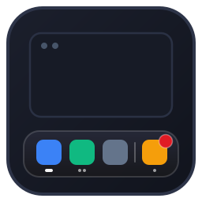

<p align="center">
  
</p>

<h1 align="center">Clean Dock</h1>

<p align="center">Minimal GNOME Shell bottom dock with multi-monitor isolation, intellihide, dynamic transparency, and notification badges.</p>

<p align="center">
  <a href="https://github.com/mjdelro/clean-dock/releases/latest"></a>
  
  <a href="LICENSE"></a>
</p>

---

Clean Dock replaces the default Overview dash with a lightweight bottom dock built natively for GNOME Shell 50 and 51 on Wayland. Each connected monitor gets its own dock showing pinned favorites alongside only the windows open on that display.

## Features

| Area | Behavior |
| :--- | :--- |
| **Multi-monitor isolation** | Renders an independent dock per monitor (or primary only), filtering running apps and window dots to each monitor's own windows. |
| **Intellihide** | Slides out when a window overlaps the dock's footprint and reveals when hovering the centered bottom-edge strip, leaving corner UI unobstructed. |
| **Dynamic transparency** | Uses a translucent `15%` pill over clear desktop space and transitions to `82%` when in the Overview or over windows. |
| **Notification badges** | Combines GNOME Message Tray counts with live `com.canonical.Unity.LauncherEntry` D-Bus counts from Discord, Slack, Steam, and Electron apps, respecting Do Not Disturb. |
| **Stable window cycling** | Orders windows by Mutter stable sequence so clicking or scrolling steps predictably across 3 or more windows and highlights the active window's dot. |

## Controls

| Input | Action |
| :--- | :--- |
| **Left click / `Enter`** | Launch an app, focus its most recently used window on that monitor, minimize a single focused window, or cycle multiple windows |
| **Middle click** | Open a new window when supported by the application, or activate single-instance apps |
| **Right click / `Shift+F10`** | Open the GNOME application menu with window list, favorites toggle, and a `Clear Notifications` action when unread badges are present |
| **Scroll wheel / touchpad** | Step forward or backward through an app's windows on that monitor |

## Quick Install

```bash
git clone https://github.com/mjdelro/clean-dock.git
cd clean-dock
./install.sh
```

On Wayland, log out and log back in once after first install so GNOME Shell loads `clean-dock@michaeldelrosar.io`. Running `./install.sh` also migrates and removes any earlier `clean-dock@local.dock` installation automatically.

## Preferences

Open preferences from **Extension Manager** or run:

```bash
gnome-extensions prefs clean-dock@michaeldelrosar.io
```

All settings update the active dock immediately without restarting GNOME Shell:

| Group | Settings |
| :--- | :--- |
| **Appearance** | Maximum icon size (`28` to `72 px`), bottom margin (`0` to `24 px`), dynamic transparency toggle, clear and solid opacity percentages |
| **Behavior and Monitors** | Intellihide toggle, hide delay (`100` to `1000 ms`), all-monitors or primary-only mode, per-monitor and per-workspace isolation, focused click action, scroll-to-cycle toggle |
| **Indicators** | Unread notification badges, per-window running dots, app name tooltips |

## Build Bundle or Uninstall

Package a distributable `.shell-extension.zip` bundle:

```bash
./install.sh --pack
```

Disable and uninstall Clean Dock:

```bash
./install.sh --uninstall
```
